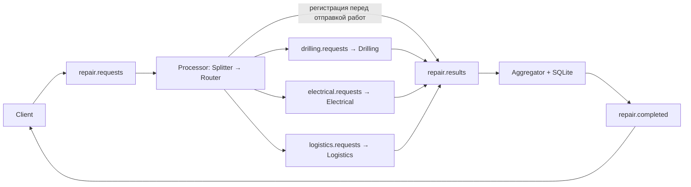

# Практическая работа №2 — Composed Message Processor

**Выполнил:** Зиннатуллин Данил, студент группы ИВТ-ЦТКС-203М.

Цель: асинхронно рассчитать комплексный ремонт скважины. Одна заявка разделяется
на независимые работы, направляется исполнителям и собирается в единую смету.
Python 3.12, pika, RabbitMQ, Docker Compose; SQLite входит в стандартную библиотеку.
Первая практика сохранена в своей ветке; эта реализация находится в `practice-2/`.

## Соответствие паттернам

| Паттерн | Реализация |
|---|---|
| Composed Message Processor | Вся цепочка из шести приложений в `docker-compose.yml` |
| Splitter | `processor/splitter.py:split`, одна подзаявка на каждый вид работы |
| Message Router / Content-Based Router | `processor/router.py:route`, явная таблица очередей |
| Aggregator | `aggregator/state.py:Aggregator`, регистрация, ожидание N/N, SQLite |
| Correlation Identifier | `common/worker.py:response`, `Aggregator._answer`: ID подзаявки → correlation_id ответа |
| Request-Reply | `common/worker.py:run`, `aggregator/main.py`, `client/main.py` |
| Return Address | `common/schemas.py:request,part`, `Aggregator.flush`: разрешённые reply_to |
| Guaranteed Delivery | `common/rabbitmq.py:connect,publish,consume`, durable, persistent, confirms, manual ack, reconnect |
| Invalid Message Channel | `common/rabbitmq.py:invalid`, очередь `repair.invalid` |

Обычная валидация не объявляется отдельным Message Filter или Content Filter.
Презентаций `1 лекция.pptx` и `2 лекция.pptx` в рабочем каталоге нет;
реализован ровно перечень паттернов из ТЗ.



Каждый узел приложения обменивается данными через RabbitMQ. Splitter и Router
работают внутри одного Processor; HTTP между приложениями отсутствует.

| Очередь | Отправитель → получатель |
|---|---|
| `repair.requests` | Client → Processor |
| `drilling.requests` | Router → Drilling |
| `electrical.requests` | Router → Electrical |
| `logistics.requests` | Router → Logistics |
| `repair.results` | Processor (регистрация), исполнители (ответы) → Aggregator |
| `repair.completed` | Aggregator → Client |
| `repair.invalid` | Любой consumer при ошибке → просмотр преподавателем в Management UI |

Все семь очередей durable, объявляются при каждом подключении. Используется
default exchange, routing key совпадает с именем очереди. Состояние брокера,
агрегатора и клиента хранится в трёх отдельных Docker volumes.

## Запуск и демонстрация

Из корня репозитория:

```sh
cd practice-2
docker compose up --build -d
docker compose ps
docker compose logs -f processor aggregator client
```

При сборке зависимости скачиваются из PyPI; требуется доступ к интернету.

Должны работать ровно семь контейнеров: RabbitMQ и шесть приложений.
При первом запуске Client автоматически отправляет три подготовленные заявки
с уникальными ID вида `AUTO-<партия>-1`, `AUTO-<партия>-2`, `AUTO-<партия>-3`:

| Скважина | Работы | Итог |
|---|---|---|
| WELL-101 | 100 м бурения, 3 единицы электрики, 2 рейса | 730000 RUB, 10 дней |
| WELL-102 | 20 м бурения, 3 единицы электрики, 2 рейса | 330000 RUB, 3 дня |
| WELL-103 | 100 м бурения, 3 единицы электрики | 650000 RUB, 10 дней |

После отправки Client непрерывно принимает готовые сметы. Подготовленные заявки
и отметки об отправке сохраняются в SQLite в volume `client-data`. При обычном
рестарте или пересоздании контейнера новые заявки автоматически не создаются.
После сбоя отправка продолжается с неподтверждённых заявок с прежними ID;
возможные повторные доставки учитывает агрегатор. Новый клиентский volume
создаёт новую партию из трёх заявок.

В INFO-логах клиента все заявки имеют единый формат: `Заявка №1 отправлена`,
`Заявка №2 отправлена` и т. д. В смете используется тот же номер.
Сквозной `request_id` также остаётся в каждой строке. Номер хранится в общей
SQLite-базе клиента: отдельные CLI-процессы и перезапуски продолжают общую
нумерацию; повтор того же `request_id` сохраняет номер. Номер не передаётся
в RabbitMQ и не меняет корреляцию. При обновлении существующего volume
сначала нумеруются сохранённые стартовые заявки; старые строки логов не меняются.
В INFO выводятся только названия работ, стоимость и срок. Полные JSON доступны
на уровне DEBUG. Для клиента задайте `CLIENT_LOG_LEVEL=DEBUG` в окружении
Compose и выполните `docker compose up -d client`. Для отдельной CLI-команды:

```sh
docker compose exec -e CLIENT_LOG_LEVEL=DEBUG client python -m client.send_demo --request-id REQ-DEBUG-001
```

Ручная отправка также доступна. Итог для `REQ-001` / `WELL-101`:
**730000 RUB, 10 дней**. Для новой заявки задавайте новый `--request-id`:

```sh
docker compose exec client python -m client.send_demo --request-id REQ-MANUAL-001
```

```sh
docker compose exec client python -m client.send_demo --scenario parallel
docker compose exec client python -m client.send_demo --scenario subset
docker compose exec client python -m client.send_demo --scenario invalid
docker compose logs -f
```

Параллельные `REQ-101` / `WELL-201` и `REQ-102` / `WELL-202` отправляются без
ожидания ответа: результаты **730000 RUB / 10 дней** и **330000 RUB / 3 дня**.
Подмножество из бурения и электрики: **650000 RUB / 10 дней**, ожидание `2/2`.
Невалидная заявка без `well_id` уходит в `repair.invalid` и не запускает расчёты.

Для новой демонстрации задайте новый ID; повтор прежнего ID с тем же содержимым
проверяет дедупликацию и не создаёт новую смету:

```sh
docker compose exec client python -m client.send_demo --request-id REQ-NEW-001
docker compose exec client python -m client.send_demo --request-id REQ-NEW-001
```

Произвольный JSON можно отправить через параметр `--file`.
Сначала скопируйте свой файл в работающий контейнер:

```sh
docker compose cp ./my-request.json client:/tmp/request.json
docker compose exec client python -m client.send_demo --file /tmp/request.json
```

RabbitMQ Management: http://localhost:15672, `guest` / `guest`. В **Queues and Streams**
видны семь очередей; готовые рабочие сообщения быстро забирают consumers, поэтому
пустая очередь после обработки — нормальный результат. В `repair.invalid` используйте
**Get messages**, режим **Ack message: Nack message requeue true**, чтобы сохранить
ошибки для просмотра. В теле есть `stage`, `reason`, `request_id`, `payload`, UTC `timestamp`.
Учебные `guest/guest` и открытые порты не предназначены для production.

## Контракты и формулы

Все сообщения — JSON UTF-8, `content_type=application/json`, `delivery_mode=2`.
Поля `message_id`, `correlation_id`, `reply_to`, когда присутствуют в JSON,
дублируются в свойствах AMQP и проверяются на совпадение.

Пример входной заявки:

```json
{"request_id":"REQ-001","well_id":"WELL-101","reply_to":"repair.completed","works":[{"work_type":"drilling","quantity":100,"unit":"meter"},{"work_type":"electrical","quantity":3,"unit":"unit"},{"work_type":"logistics","quantity":2,"unit":"trip"}]}
```

Непустые `request_id`, `well_id`: до 200 символов. В `works` от одной до трёх
работ без повторов типа. Количество — целое от 1 до 1000000; bool, дроби,
неверные единицы, неизвестные типы и неразрешённые обратные адреса отвергаются.

Подзаявка содержит `message_id`, `request_id`, `well_id`, `work_type`, `quantity`,
`unit`, `reply_to=repair.results`. UUID подзаявки устойчиво вычисляется из
содержимого исходной заявки и типа работы: повторная доставка получает тот же ID.
Ответ содержит новый `message_id`, `correlation_id=message_id подзаявки`,
`request_id`, `well_id`, `work_type`, целые `cost_rub`, `duration_days`, `status=success`.

Итог: `request_id`, `well_id`, `status=completed`, список `estimates` из
`work_type/cost_rub/duration_days`, `total_cost_rub`, `total_duration_days`,
`duration_rule=parallel_max`. Дополнительно передаются устойчивый `message_id`
итога и `correlation_id=request_id`.

| Исполнитель | Стоимость, RUB | Длительность, дни |
|---|---|---|
| Drilling | quantity × 5000 | ceil(quantity / 10), целочисленно `(quantity + 9) // 10` |
| Electrical | quantity × 50000 | quantity |
| Logistics | quantity × 40000 | quantity |

`total_cost_rub = sum(cost_rub)`, **`total_duration_days = max(duration_days)`**.
Деньги рассчитываются только целыми числами, без float. Формулы находятся в
отдельных `drilling/main.py`, `electrical/main.py`, `logistics/main.py`.

Задержки имитации: `DRILLING_DELAY_SEC=4`, `ELECTRICAL_DELAY_SEC=2`,
`LOGISTICS_DELAY_SEC=1`. Настраиваются через окружение Compose; это секунды
вычислений, а не реальные дни ремонта. `AGGREGATION_TIMEOUT_SEC=30` управляет
диагностикой незавершённых заявок. Для изменения окружения пересоздайте сервисы
командой `docker compose up -d`.

## Регистрация, дубли и восстановление

1. Processor полностью валидирует заявку до отправки любой работы.
2. В `repair.results` публикуется и подтверждается служебное сообщение
   `kind=registration` с исходными полями и `parts`. Только после confirm
   публикуются работы; каждая публикация также подтверждается брокером.
3. Aggregator сохраняет регистрацию в SQLite. Он принимает ответ только при
   совпадении request_id, well_id, work_type и correlation_id с зарегистрированной
   подзаявкой. Ранние ответы записываются в SQLite и проверяются после регистрации.
4. Ответы уникальны по `(request_id, work_type)`; повтор с тем же correlation_id
   и расчётом игнорируется, конфликтующий ответ отправляется в invalid.
   Конфликтующий повтор регистрации под тем же request_id также отвергается.
5. При N/N смета записывается транзакционно вместе с последним ответом.
   Она остаётся неопубликованной в SQLite до успешного publisher confirm.
   Незавершённые публикации повторяются после reconnect или рестарта.
6. Client сохраняет полученные сметы в SQLite с уникальным request_id, поэтому
   повторная доставка не создаёт второй логический результат.

Все consumers используют prefetch=1 и ручной ack **после** обработки и
подтверждения исходящих публикаций. Ошибка JSON или бизнес-валидации получает
ack только после подтверждённой отправки в invalid. Инфраструктурная ошибка
не превращается в бизнес-ошибку: соединение закрывается, неподтверждённое
сообщение возвращается брокером, приложение переподключается через 2 секунды.

Модель доставки — **at least once**. Падение между confirm и записью `sent=1`
может повторить публикацию того же итога с тем же ID. Бизнес-дедупликация клиента
и агрегатора устраняет повторный учёт, но физическая exactly-once доставка
не заявляется. Вычисление исполнителя при повторной доставке может повториться.
Состояние дедупликации сохраняется в volumes; удаление volumes удалит эту защиту.

Остановка исполнителя и рестарт агрегатора:

```sh
docker compose stop logistics
docker compose exec client python -m client.send_demo --request-id REQ-RECOVERY-001
docker compose logs aggregator
docker compose restart aggregator
docker compose start logistics
docker compose logs -f aggregator client
```

До возвращения logistics агрегатор остаётся на `2/3` и пишет, какой ответ
отсутствует; ложной completed-сметы нет. После запуска получает третью часть
и завершает заявку. `docker compose restart rabbitmq` дополнительно демонстрирует
переподключение. Остановка через `docker compose down` сохраняет volumes;
`down -v` уничтожает учебные данные и не нужна для штатной демонстрации.

Неизвестный ранний ответ по истечении диагностического таймаута отправляется в
invalid; зарегистрированные незавершённые заявки продолжают ждать реальные ответы.
SQLite хранится с WAL и synchronous=FULL. Незавершённые и завершённые заявки
автоматически не удаляются. Решение учебное: нет реальных подрядчиков,
авторизации отправителей, распределённой БД или очистки истории. Допускается
один экземпляр каждого сервиса; горизонтальное масштабирование здесь не заявлено.

## Проверки

Модульные тесты без RabbitMQ:

```sh
docker compose exec client python -m pytest -q
```

Или локально: Python 3.12, `python -m venv .venv`, активация окружения,
`python -m pip install -r requirements.txt`, `python -m pytest -q`.

Интеграционный pytest запускается **на хосте** при работающих семи сервисах
и доступном `docker` CLI. Он создаёт уникальные TEST-заявки, проверяет A–F,
останавливает logistics, перезапускает агрегатор и RabbitMQ. Применять только
к локальному учебному проекту. PowerShell:

```powershell
$env:RUN_INTEGRATION = '1'
./.venv/Scripts/python -m pytest -q -s tests/test_integration.py
Remove-Item Env:RUN_INTEGRATION
```

## Pull Request

Рабочая ветка: `practice-2/composed-message-processor`.
[Pull Request №2](https://github.com/ZinnatullinDA/integration_patterns/pull/2).
